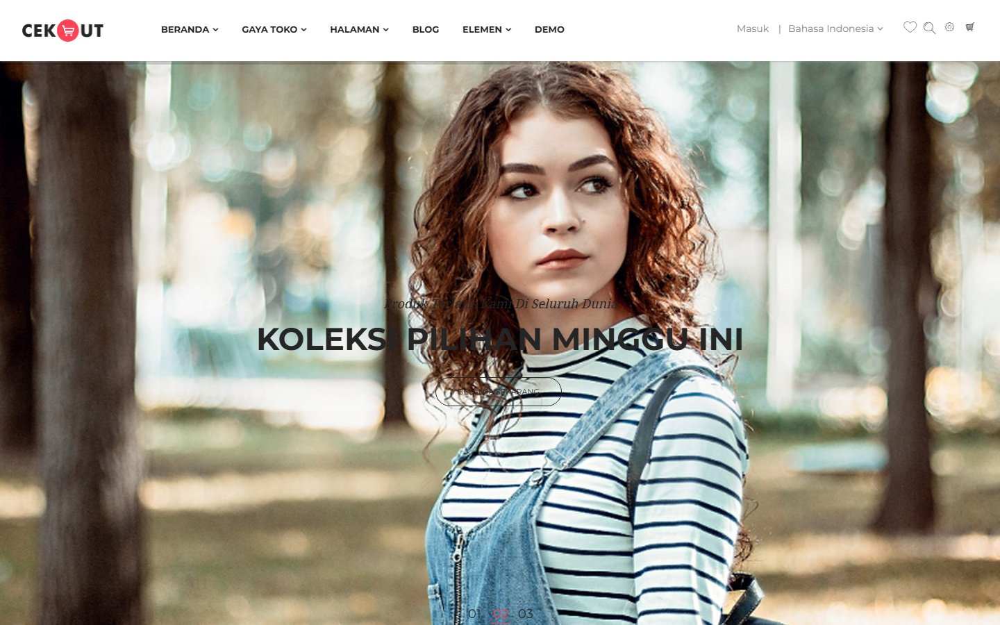
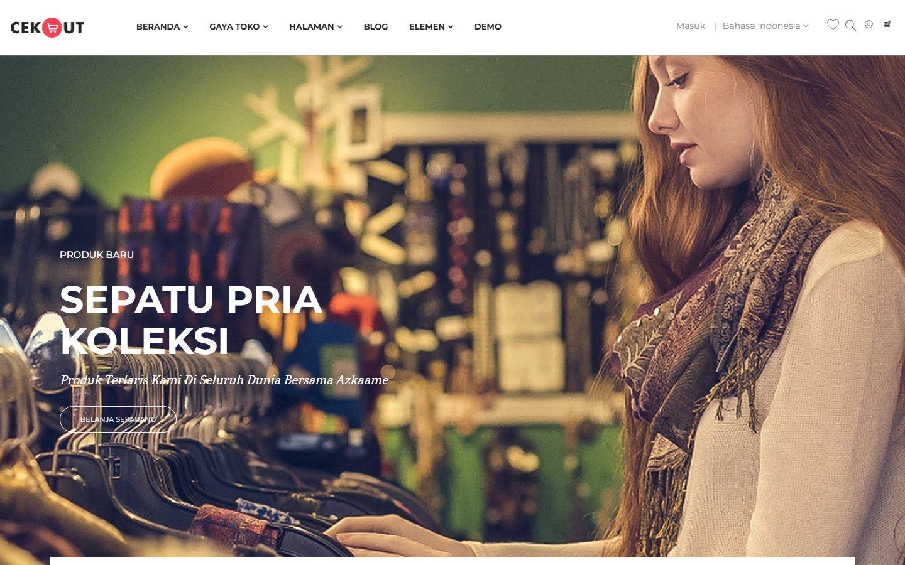
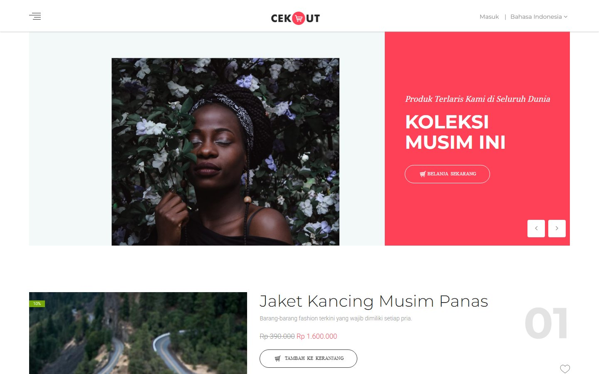
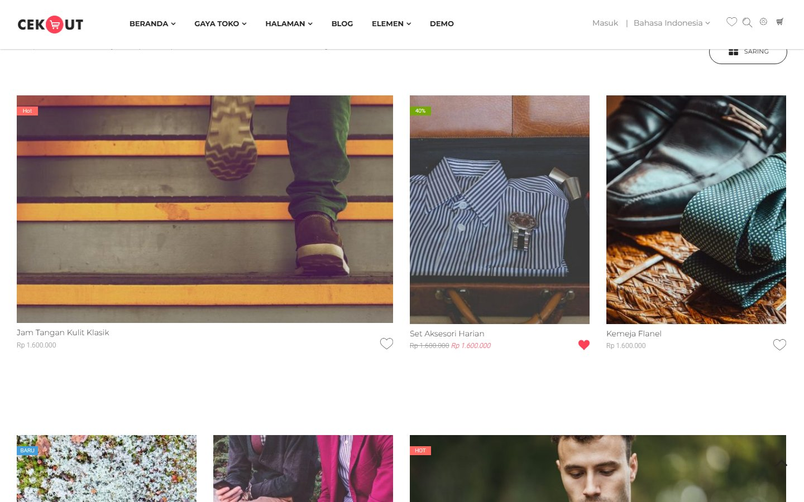
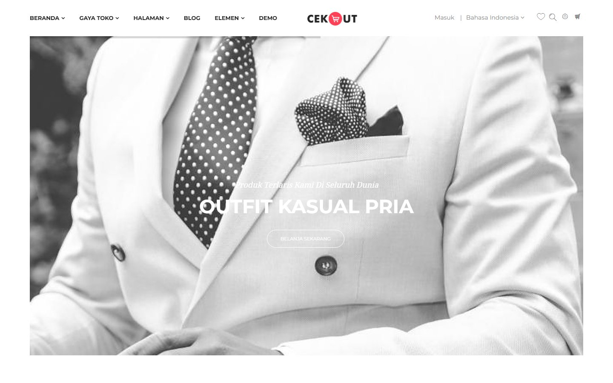
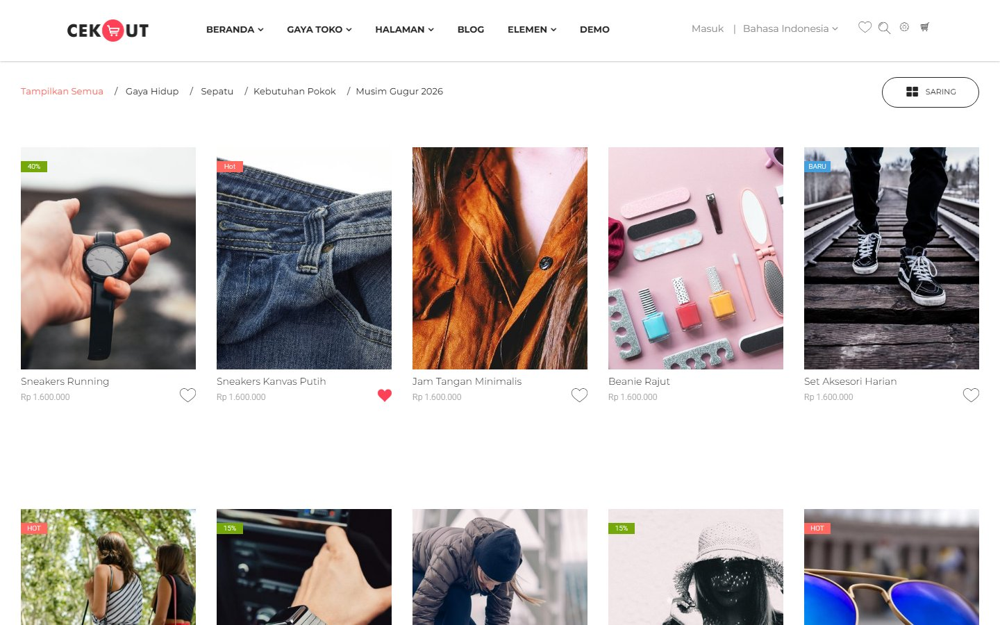
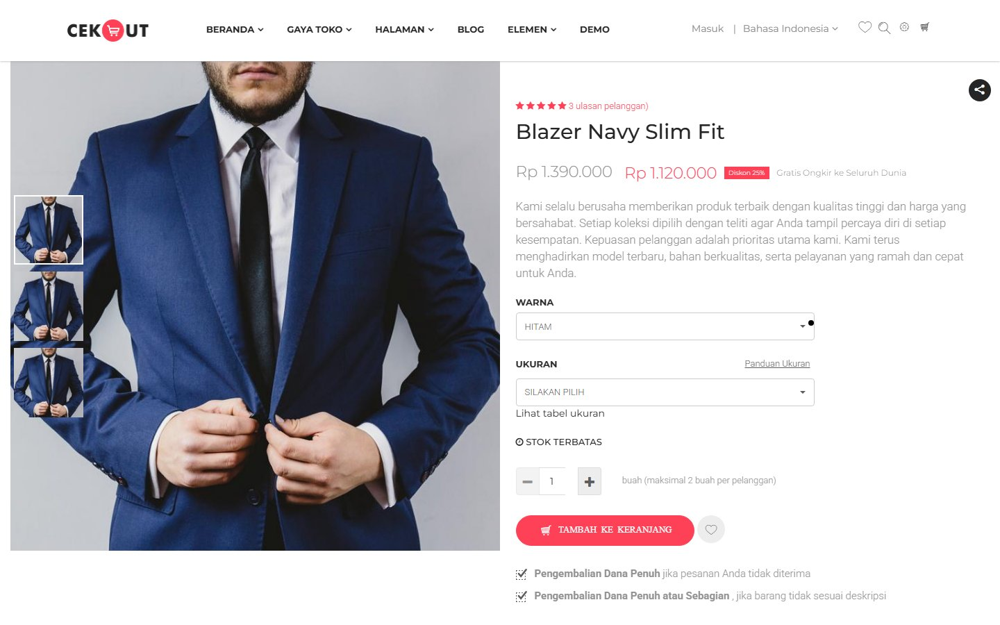
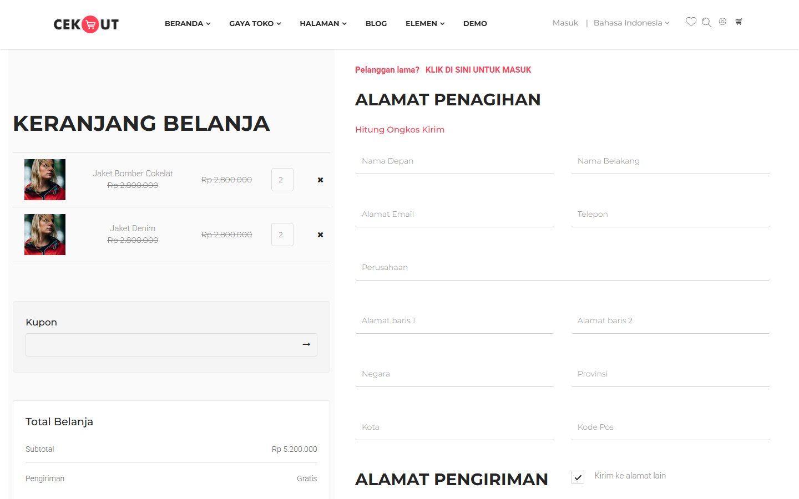
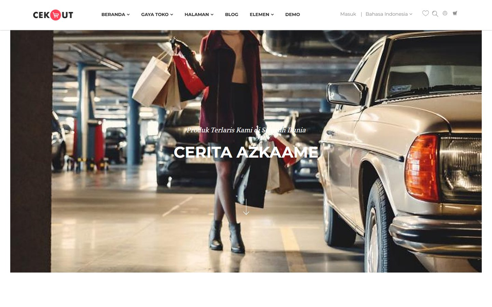
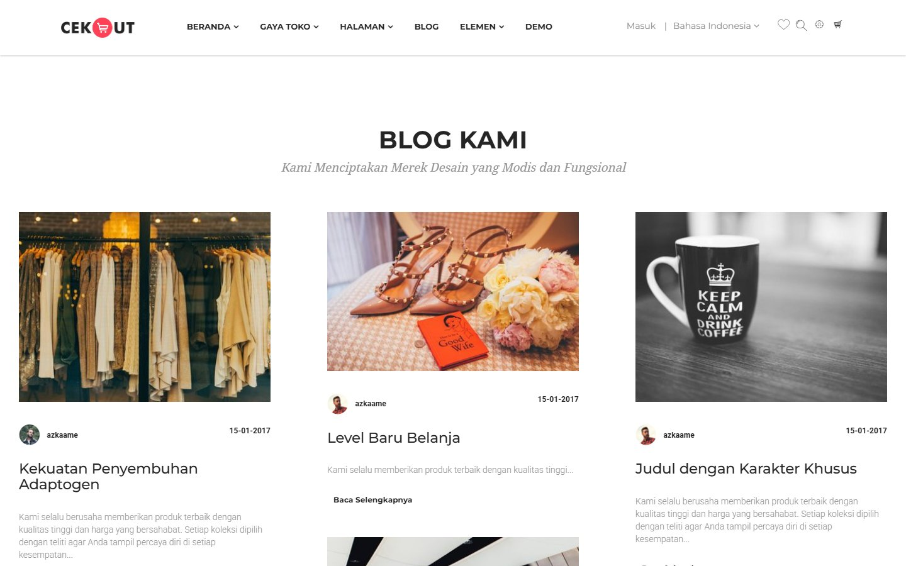

<div align="center">

<picture>
  <source media="(prefers-color-scheme: dark)" srcset="HTML/images/logo-white.png">
  
</picture>

# cekOut — Website E-Commerce Fashion

**Toko online fashion & lifestyle berbahasa Indonesia.**
Tampilan modern, responsif, dan siap dipakai untuk etalase produk pakaian, sepatu, tas, dan aksesori.


<br>



</div>

---

## ✨ Fitur

- 🛍️ **31 halaman siap pakai** — beranda (6 variasi), toko, detail produk, keranjang, wishlist, blog, tentang, FAQ, kontak, dan 404
- 🇮🇩 **Sepenuhnya berbahasa Indonesia**, dengan harga dalam Rupiah
- 📱 **Responsif** — nyaman dibuka di desktop, tablet, maupun ponsel
- 🎞️ **Slider & animasi** halus di halaman beranda
- 🛒 **Keranjang belanja, wishlist, dan checkout** lengkap dengan formulir alamat
- 🔍 **Filter & kategori produk** (gaya hidup, sepatu, kebutuhan pokok, dan lainnya)
- 📰 **Blog** untuk artikel dan berita toko

## 📸 Tampilan

### Beranda

<table>
  <tr>
    <td width="50%"></td>
    <td width="50%"></td>
  </tr>
  <tr>
    <td align="center"><sub>Banner koleksi</sub></td>
    <td align="center"><sub>Slider "Koleksi Musim Ini"</sub></td>
  </tr>
  <tr>
    <td></td>
    <td></td>
  </tr>
  <tr>
    <td align="center"><sub>Produk unggulan</sub></td>
    <td align="center"><sub>Koleksi pria</sub></td>
  </tr>
</table>

### Belanja

<table>
  <tr>
    <td width="50%"></td>
    <td width="50%"></td>
  </tr>
  <tr>
    <td align="center"><sub>Katalog toko</sub></td>
    <td align="center"><sub>Detail produk</sub></td>
  </tr>
  <tr>
    <td></td>
    <td></td>
  </tr>
  <tr>
    <td align="center"><sub>Keranjang &amp; checkout</sub></td>
    <td align="center"><sub>Tentang kami</sub></td>
  </tr>
</table>

### Blog



## 🚀 Cara Menjalankan

Website ini statis (HTML, CSS, JavaScript), jadi tidak perlu instalasi apa pun.

**Cara cepat:** buka file `HTML/index.html` langsung di browser.

**Lewat server lokal** (disarankan, agar semua fitur berjalan normal):

```bash
cd HTML
python -m http.server 8000
```

Lalu buka **http://localhost:8000** di browser.

## 📁 Struktur Folder

```
.
├── HTML/
│   ├── index.html … index6.html   # variasi beranda
│   ├── shop*.html                 # katalog & detail produk
│   ├── shop-cart.html             # keranjang & checkout
│   ├── blog*.html, about*.html, contact*.html, faq.html, 404.html
│   ├── css/                       # stylesheet
│   ├── js/                        # script & plugin
│   ├── fonts/                     # ikon & font
│   └── images/                    # foto produk, banner, logo
└── screenshots/                   # gambar untuk README
```

## 🙏 Kredit

- Dikembangkan dari template HTML **Empor** karya BrighThemes, lalu dilokalkan ke Bahasa Indonesia dan diberi identitas baru **cekOut**.
- Foto produk dan banner dari [StockSnap](https://stocksnap.io) (lisensi **CC0**, bebas dipakai) melalui [Openverse](https://openverse.org).

## 📬 Kontak

**azkaame** — [azkaaze56@gmail.com](mailto:azkaaze56@gmail.com)

<div align="center">
<sub>© 2026 cekOut · Dibuat dengan ❤️ oleh azkaame</sub>
</div>
